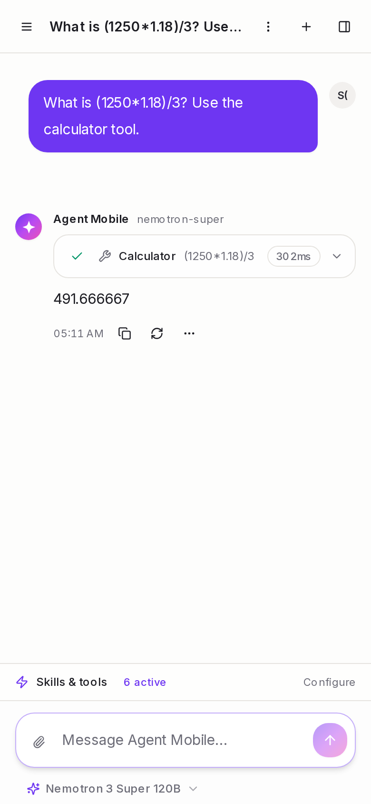

# Agent Mobile

A ChatGPT-style AI chat app with skills and tools, built as a **static Next.js 15 app** (TypeScript, Tailwind) on top of the **Base44 backend**: authentication, database, realtime sync, file storage and the AI chat function all run on Base44. The same build ships as a website and is **bundled inside the Android APK** with Capacitor.



## Features

- Streaming chat with tool calls shown as cards (calculator, weather, web search, current time, read attached file)
- Regenerate keeps earlier answers as switchable variants; edit a message to branch the conversation
- Rename, pin, search, delete and export conversations; instant cross-device sync through realtime subscriptions
- File and image attachments (Base44 storage)
- Email/password accounts with email verification and password reset
- Models served by **NVIDIA NIM** and **OpenRouter** with automatic fallback

## Architecture

```
Browser / Android WebView (static files from out/)
        |  @base44/sdk: auth, entities, realtime, storage
        v
Base44 backend
  - entities: Conversation, Message, ToolCall (row-level security: users see only their own data)
  - function agentChat   auth, persistence, tool loop, streaming, provider fallback
  - function agentTools  calculator, weather, web search, time, file reading
        |  HTTPS, API keys held as backend secrets
        v
NVIDIA NIM  ->  OpenRouter   (ordered fallback chain)
```

There is **no server to host**. `next build` produces a static export in `out/` and everything dynamic is the Base44 backend.

### AI providers and secrets

`NVIDIA_API_KEY` and `OPENROUTER_API_KEY` are secrets on the Base44 app. They are never in this repository, never in the client bundle and never sent to the browser. `agentChat` walks the fallback chain on HTTP 429, 5xx, 404/410, timeouts, network errors and empty replies. A 400 is not retried because it would fail identically everywhere. Models offered (all verified to answer):

| Id | Model | Provider |
| --- | --- | --- |
| `nemotron-super` (default) | Nemotron 3 Super 120B | NVIDIA |
| `gpt-oss-20b` | GPT-OSS 20B | NVIDIA |
| `nemotron-super-or` | Nemotron 3 Super | OpenRouter |
| `nemotron-omni-or` | Nemotron Omni 30B | OpenRouter |

## Getting started

```bash
npm install
npm run dev          # http://localhost:3000
```

No configuration is required: the Base44 app id and functions origin are public identifiers committed as defaults in `src/lib/base44/client.ts`. To target another Base44 deployment set `NEXT_PUBLIC_BASE44_APP_ID` and `NEXT_PUBLIC_BASE44_APP_URL` (see `.env.example`).

### Scripts

| Command | What it does |
| --- | --- |
| `npm run dev` | development server |
| `npm run build` | static export to `out/` |
| `npm run typecheck` | `tsc --noEmit` |
| `npm run lint` | ESLint |
| `npm test` | unit tests (Vitest) |
| `npm run test:e2e` | browser tests (Playwright) |

## Project layout

```
base44/
  entities/            entity schemas (Conversation, Message, ToolCall)
  functions/
    agentChat.ts       deployed chat function
    agentTools.ts      generated: tools function (calculator embedded from src/lib/tools)
    _src/              templates used by scripts/build-function.mjs
src/
  app/                 routes: /, /login, /register, /chat
  components/          chat UI, auth, settings
  lib/base44/          SDK client, auth, data layer, NDJSON stream reader
  lib/store/           Zustand chat store
  lib/tools/           tool registry and the calculator
scripts/               function build, Android asset helpers
android/               Capacitor Android project
```

### Backend functions

`agentTools.ts` is generated so the calculator is shared with, and unit-tested in, the frontend:

```bash
node scripts/build-function.mjs
```

Deploy `agentChat.ts` and `agentTools.ts` as Base44 backend functions and set the two provider secrets.

### Chat protocol

The client POSTs to the `agentChat` function with `mode: send | regenerate | edit` and reads newline-delimited JSON events: `conversation`, `message_start`, `delta`, `tool_call`, `tool_result`, `message_end`, `error`, `done`. State is also persisted to entities, so every open tab and device receives updates through realtime subscriptions.

## Testing

- **Unit** (`npm test`): calculator, variants, commands, export, retry and utilities.
- **Backend** (run against the deployed functions): auth and validation, memory, tools, regenerate and edit, every model, and the provider fallback chain.
- **Browser** (`npm run test:e2e`): landing, login errors, auth guard, not-found page.

## Android

The web app is bundled inside the APK (`webDir: out`). It starts instantly and does not depend on any web host being online. Only the Base44 backend is contacted, over HTTPS.

```bash
npm run build          # static export to out/
npx cap sync android   # copy out/ into the Android project
cd android && ./gradlew assembleRelease
```

### Signed release builds (CI)

`.github/workflows/android-release.yml` builds, signs and verifies the APK, checks that `index.html` is inside it, uploads it as an artifact and attaches it to a GitHub release on `v*` tags. Required repository secrets:

| Secret | Purpose |
| --- | --- |
| `ANDROID_KEYSTORE_BASE64` | release keystore, base64 encoded |
| `ANDROID_KEYSTORE_PASSWORD` | keystore password |
| `ANDROID_KEY_ALIAS` | key alias |
| `ANDROID_KEY_PASSWORD` | key password |

Run it from the Actions tab (**Android release**), or push a tag: `git tag v1.0.0 && git push --tags`.

### Install on a device

Download the `.apk` from the release (or workflow artifact), transfer it to an Android device and open it, or `adb install agent-mobile-<tag>.apk`. Allow installs from unknown sources if prompted.

## Access control

Registration and sign-in are handled by Base44. Whether new users can sign up freely or must be approved is a Base44 app setting (Settings, Authentication). Data access is enforced server-side by row-level security, so a user can only read or modify their own conversations.
